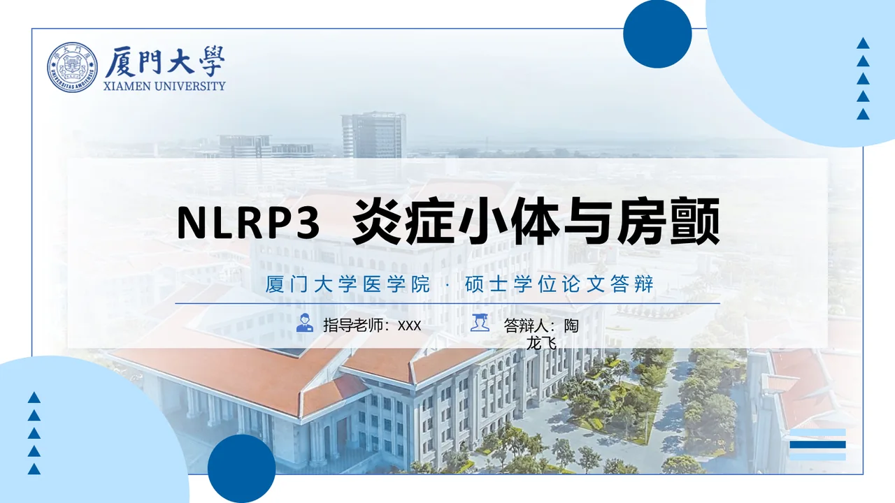
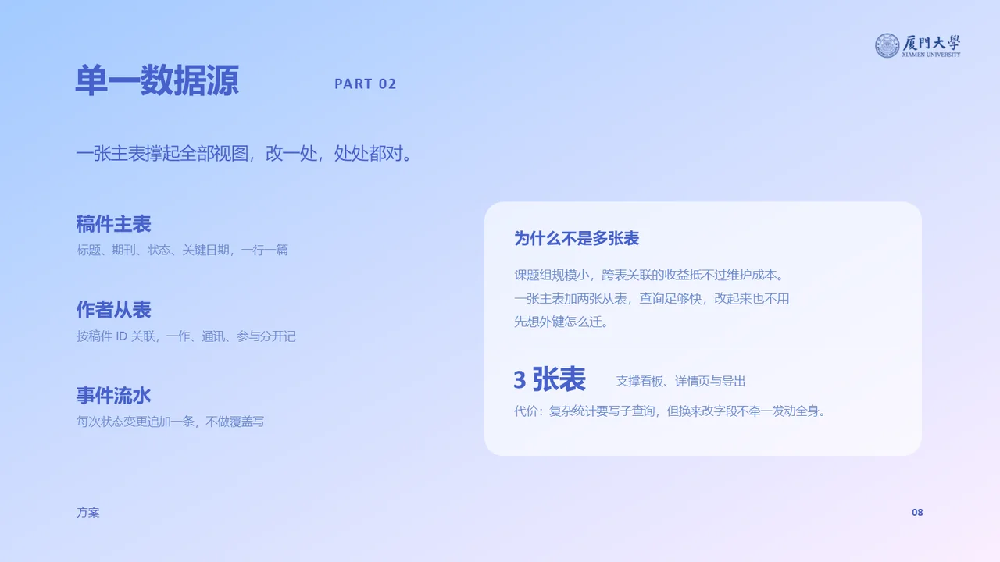

# xmu-ppt — Xiamen University PPT templates

[](LICENSE)
[](docs/templates.md)
[](docs/quickstart.md)
[](https://github.com/Longfei-Tao/xmu-ppt/stargazers)

Turn a topic, outline, or source material into a Xiamen University style presentation with a file-capable AI agent.

**[Browse every slide online](https://longfei-tao.github.io/xmu-ppt/)** · [中文首页](README.md) · [Getting started (Chinese)](docs/quickstart.md) · [Tool setup](docs/tools/README.md)

<table>
  <tr>
    <td align="center" width="33%">
      <a href="https://longfei-tao.github.io/xmu-ppt/#defense/1"></a><br/>
      <sub><b>Xiayuan Qingri</b> — 14-slide defense deck: emblem, campus photography and type scale kept</sub>
    </td>
    <td align="center" width="33%">
      <a href="https://longfei-tao.github.io/xmu-ppt/#group/8"></a><br/>
      <sub><b>Nanqiang Weilan</b> — 11-slide group report: body layouts recomposed per page, not card grids</sub>
    </td>
    <td align="center" width="33%">
      <a href="https://longfei-tao.github.io/xmu-ppt/#native/3"></a><br/>
      <sub><b>Phoenix Flower</b> — 9 slides filled inside the original PPTX; photos and bars untouched</sub>
    </td>
  </tr>
</table>

<sub>All three are PowerPoint screenshots of real exported files, not design mockups. [Flip through them online →](https://longfei-tao.github.io/xmu-ppt/)</sub>

> Repository and project name: `xmu-ppt`. The skill inside is still named `ppt-master` after its upstream. Former names `xmu-ppt-master` and "XMU PPT Master" refer to this same repository.

## What it is, and what it is not

| | |
| --- | --- |
| **Is** | An Agent Skill: give it a topic or material, it authors each SVG page and exports an editable `.pptx` |
| **Is** | 14 XMU template decks (3 refined + 11 themed); 13 of them can also fill an existing PPTX in place |
| **Is not** | Not an online service and not a marketplace plugin; it needs local Python and an agent that can run commands |
| **Not guaranteed** | Complex charts and original layouts are not reproduced exactly, and photos stay as images |

## What it does

- Provides 14 SVG template styles and 13 source PPTX templates for native filling.
- Uses an AI agent to structure content, author slides, and run local Python export tools.
- Exports `.pptx` files with native text and simple shapes where supported. Complex layouts and editability require review.
- Supports topic-only proposal drafts; factual research presentations need real source material.

This repository is an Agent Skill with local tools. It is not a standalone topic-to-slides service, remote MCP server, or published marketplace package.

## First run

Install Python 3.10+ and Git, then clone the repository and create a virtual environment:

```bash
git clone https://github.com/Longfei-Tao/xmu-ppt.git xmu-ppt
cd xmu-ppt
python -m venv .venv
```

Install core dependencies using `.venv/bin/python -m pip install -r skills/ppt-master/requirements-core.txt` on macOS/Linux, or `.venv\Scripts\python.exe -m pip install -r skills/ppt-master/requirements-core.txt` on Windows.

Open the repository in an agent that can read files and execute Python, then ask:

```text
Read skills/ppt-master/SKILL.md and follow the XMU workflow.
Create a 10-slide proposal on collaboration within a campus research team.
Use the repository's virtual environment. Do not invent research data or references.
Return the actual PPTX path and any material limitations.
```

Native discovery instructions are documented for [Codex](docs/tools/codex.md), [Claude Code](docs/tools/claude-code.md), [GitHub Copilot](docs/tools/copilot.md), and [Gemini CLI](docs/tools/gemini-cli.md). Documentation adaptation does not mean end-to-end compatibility has been tested. If CC Switch manages your skills, maintain and distribute them there instead of overwriting generated client copies.

No Git? Download [main.zip](https://github.com/Longfei-Tao/xmu-ppt/archive/refs/heads/main.zip) and run the same commands inside the extracted `xmu-ppt-main` folder. ZIP copies cannot be updated with `git pull`; download again to upgrade.

### Updating

```bash
python skills/ppt-master/scripts/update_repo.py
```

It refuses to run while you have uncommitted local changes, then pulls the latest code and reinstalls dependencies only when `requirements.txt` changed (`--skip-pip` skips that step). `git pull` works too, but can overwrite files you have edited.

## Limits and licensing

The Nanqiang Weilan style currently supports SVG export only. Font availability and the target presentation app can change layout. Review every slide before presenting; native text does not imply that every chart or object is editable.

This is an unofficial personal project with no confirmed university endorsement. Code and template structure are covered by [MIT](LICENSE); university logos, photographs, and other third-party assets are excluded. Redistribution permissions for some existing materials remain [unverified](docs/assets.md). Public download availability is not a redistribution license.

[Advanced commands](docs/advanced.md) · [Contributing](CONTRIBUTING.md) · [Credits](CREDITS.md)
