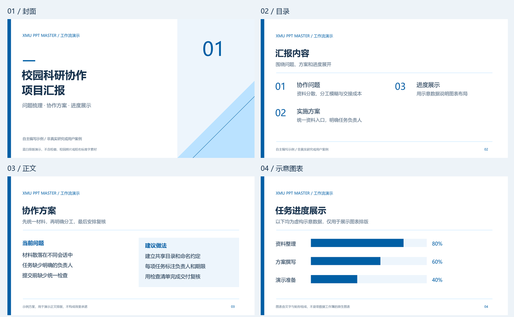

# XMU PPT Master

Turn a topic, outline, or source material into a Xiamen University style presentation with a file-capable AI agent.

[中文首页](README.md) · [Getting started (Chinese)](docs/quickstart.md) · [Tool setup](docs/tools/README.md)



This is an original blue-and-white workflow demo, not a real research report. It contains no university logo or campus photography. [Download the PPTX](examples/quickstart/demo.pptx) or inspect the [brief and SVG sources](examples/quickstart/README.md). See the [existing template gallery](docs/templates.md) for university-branded layouts.

## What it does

- Provides 14 SVG template styles and 13 source PPTX templates for native filling.
- Uses an AI agent to structure content, author slides, and run local Python export tools.
- Exports `.pptx` files with native text and simple shapes where supported. Complex layouts and editability require review.
- Supports topic-only proposal drafts; factual research presentations need real source material.

This repository is an Agent Skill with local tools. It is not a standalone topic-to-slides service, remote MCP server, or published marketplace package.

## First run

Install Python 3.10+ and Git, then clone the repository and create a virtual environment:

```bash
git clone https://github.com/Longfei-Tao/xmu-ppt.git xmu-ppt-master
cd xmu-ppt-master
python -m venv .venv
```

Install core dependencies using `.venv/bin/python -m pip install -r skills/ppt-master/requirements-core.txt` on macOS/Linux, or `.venv\Scripts\python.exe -m pip install -r skills/ppt-master/requirements-core.txt` on Windows.

Open the repository in an agent that can read files and execute Python, then ask:

```text
Read skills/ppt-master/SKILL.md and follow the XMU workflow.
Create a 10-slide proposal on collaboration within a campus research team.
Use the repository's virtual environment. Do not invent research data or references.
Return the actual PPTX path and any material limitations.
```

Native discovery instructions are documented for [Codex](docs/tools/codex.md), [Claude Code](docs/tools/claude-code.md), [GitHub Copilot](docs/tools/copilot.md), and [Gemini CLI](docs/tools/gemini-cli.md). Documentation adaptation does not mean end-to-end compatibility has been tested. If CC Switch manages your skills, maintain and distribute them there instead of overwriting generated client copies.

## Limits and licensing

The Nanqiang Weilan style currently supports SVG export only. Font availability and the target presentation app can change layout. Review every slide before presenting; native text does not imply that every chart or object is editable.

This is an unofficial personal project with no confirmed university endorsement. Code and template structure are covered by [MIT](LICENSE); university logos, photographs, and other third-party assets are excluded. Redistribution permissions for some existing materials remain [unverified](docs/assets.md). Public download availability is not a redistribution license.

[Advanced commands](docs/advanced.md) · [Contributing](CONTRIBUTING.md) · [Credits](CREDITS.md)
