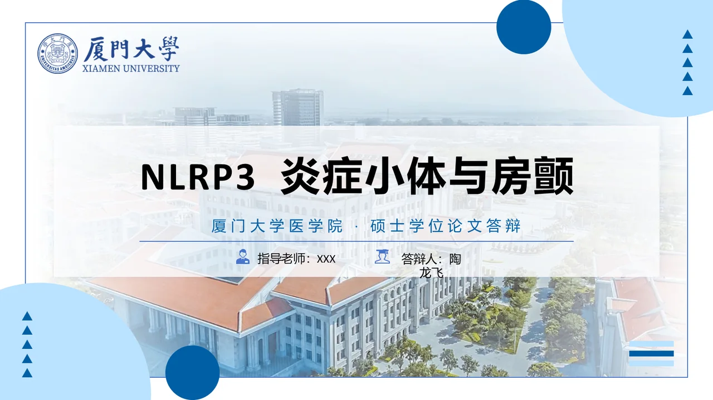
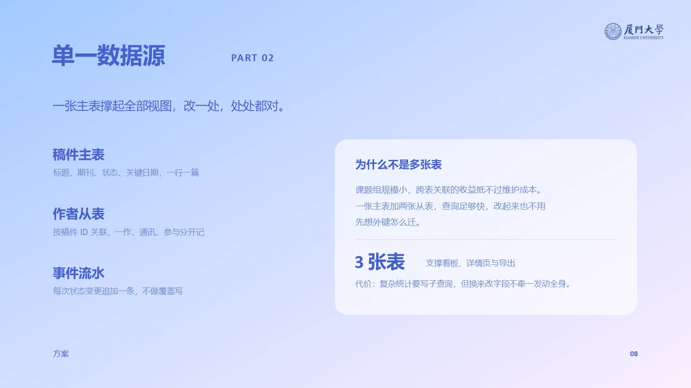
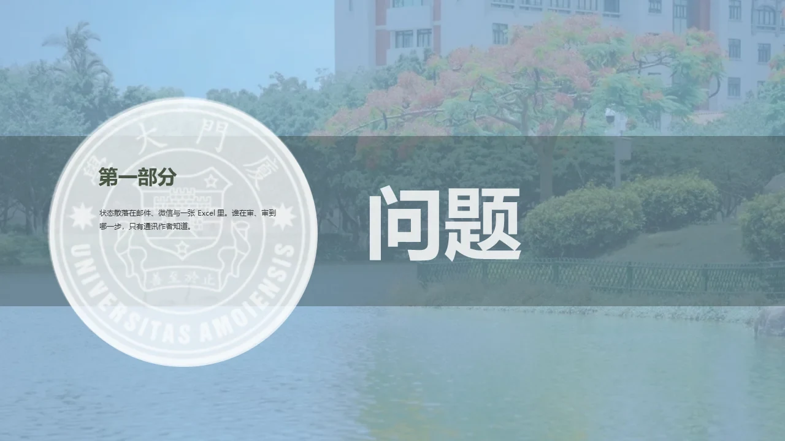
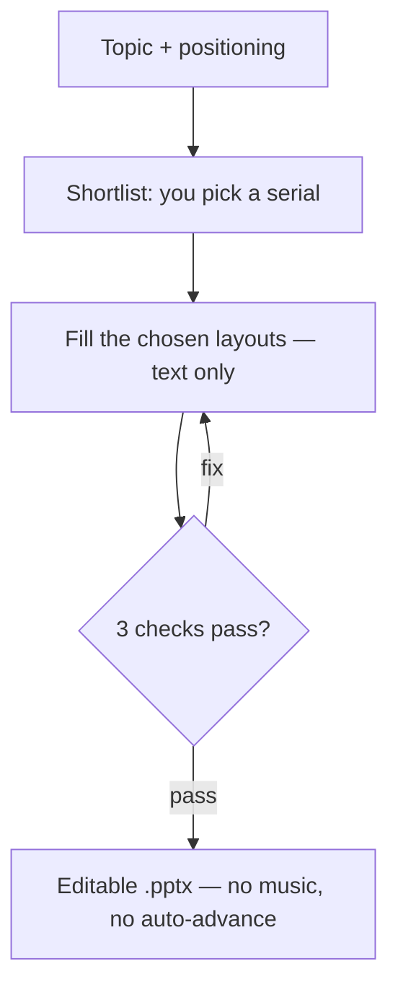

<div align="center">

# xmu-ppt

**A Xiamen University template library and slide engine for AI agents.**
Describe a topic. It picks a real template, fills the existing layouts, and exports an editable `.pptx` — no redrawing, no design detours.

[](https://github.com/Longfei-Tao/xmu-ppt/releases)
[](LICENSE)
[](docs/quickstart.md)
[](docs/templates.md)
[](https://github.com/Longfei-Tao/xmu-ppt/stargazers)

[简体中文](README.zh-CN.md) · [Template gallery](https://longfei-tao.github.io/xmu-ppt/templates/) · [Slide-by-slide preview](https://longfei-tao.github.io/xmu-ppt/) · [Quick start](#quick-start) · [FAQ](docs/faq.md)

</div>

<table>
  <tr>
    <td align="center" width="33%">
      <a href="https://longfei-tao.github.io/xmu-ppt/#defense/1"></a><br/>
      <sub><b>Xiayuan Qingri</b> — 14-slide defense deck: emblem, campus photography and type scale kept</sub>
    </td>
    <td align="center" width="33%">
      <a href="https://longfei-tao.github.io/xmu-ppt/#group/8"></a><br/>
      <sub><b>Nanqiang Weilan</b> — 11-slide group report: body layouts recomposed per page, not card grids</sub>
    </td>
    <td align="center" width="33%">
      <a href="https://longfei-tao.github.io/xmu-ppt/#native/3"></a><br/>
      <sub><b>Phoenix Flower</b> — 9 slides filled inside the original PPTX; photos and bars untouched</sub>
    </td>
  </tr>
</table>

<sub>All three are PowerPoint screenshots of real exported files, not design mockups. [Flip through them online →](https://longfei-tao.github.io/xmu-ppt/)</sub>

> **Unofficial personal project.** Not affiliated with, endorsed by, or licensed by Xiamen University. Code and template structure are [MIT](LICENSE); the university emblem, campus photographs and fonts are **not** covered by that license. Redistribution status for some existing assets is still [under review](docs/assets.md).

## Why this exists

Many "AI slide" tools redraw every page from scratch. You get a deck, but the institutional identity is gone: the logo is approximated, the photos are swapped, the grid quietly drifts.

This project takes the opposite route. It treats a template as a **fixed set of layouts** and only replaces the words inside them — so the emblem, the photography, the decoration and the alignment stay exactly where the designer put them. When the text does not fit the box, the build fails instead of silently overflowing.

## What it is, and what it is not

- **It is** an Agent Skill: give it a topic or material, it selects templates, maps content to slides and exports an editable `.pptx`.
- **It ships** 15 XMU template decks (3 refined + 12 themed); 14 of them include a source `.pptx` that can be filled in place.
- **It is not** an online service, a marketplace plugin, or a remote MCP server — it needs local Python and an agent that can run commands.
- **Not guaranteed:** complex charts are not reproduced exactly, and photographs stay as images. Review every slide before presenting.

## How it works



The agent stops after the shortlist and waits. It does not design pages, does not restyle the deck, and does not decide on your behalf. Page count is not fixed: it follows from the content and the layouts available in the template you chose.

Before export it checks **content completeness**, **text fit** against the real geometry of each text box, and **template consistency**. A failure sends the copy back for a fix instead of shipping a page that overflows.

## Three routes

| You say | Route | What happens | Trade-off |
| --- | --- | --- | --- |
| "Use this template, keep the layout" | **Native fill** (default) | Clone the source pages, replace text runs, keep transitions | Wording is bounded by each text box |
| "Just a topic — the layout can be free" | **SVG authoring** | Hand-author each page as SVG, then export to PPTX | Layout fidelity is approximate |
| "Keep every page, byte for byte" | **Strict native** | Copy the whole PPTX, overwrite only the named text nodes | Output has the template's original page count |

`Nanqiang Weilan` ships no source `.pptx`, so it supports the SVG route only.

## Quick start

**Requirements:** Python 3.10+, Git (or the ZIP below), and an AI agent that can read files and run Python.

### 1. Clone

```bash
git clone https://github.com/Longfei-Tao/xmu-ppt.git xmu-ppt
cd xmu-ppt
```

Without Git, download [main.zip](https://github.com/Longfei-Tao/xmu-ppt/archive/refs/heads/main.zip) and work inside the extracted `xmu-ppt-main` folder.

> **Just want the skill?** Download the [skill-only ZIP](https://github.com/Longfei-Tao/xmu-ppt/releases/latest/download/xmu-ppt-skill.zip) (13.7 MiB) from [Releases](https://github.com/Longfei-Tao/xmu-ppt/releases). It contains code, docs and SVG layout definitions only — no third-party template originals, preview screenshots or machine-local paths. Point `root.local.json` at your own template folder to get the same picker, per-page previews and Native fill on your machine.

### 2. Install dependencies

```powershell
# Windows PowerShell
python -m venv .venv
.\.venv\Scripts\python.exe -m pip install -r skills/xmu-ppt/requirements-core.txt
```

```bash
# macOS / Linux
python3 -m venv .venv
.venv/bin/python -m pip install -r skills/xmu-ppt/requirements-core.txt
```

### 3. Ask your agent

Open the repository in a file-capable agent and send:

```text
Read skills/xmu-ppt/SKILL.md and follow its workflow.

Topic: a campus research collaboration report, about 10 slides.
Include material management, ownership, schedule and submission review.
There is no measured data — write it as a proposal, do not invent results.

Show me the template shortlist and wait for my choice before authoring.
Use this repository's virtual environment and return the actual PPTX path.
```

That is the whole setup — no API key, no global configuration, no model is called by this repository.

### Update

```bash
python skills/xmu-ppt/scripts/update_repo.py
```

It stops if you have uncommitted changes, then pulls and reinstalls dependencies **only when `requirements.txt` changed** (`--skip-pip` skips that step). A plain `git pull` also works, but may overwrite templates you edited.

## Use it in your agent

| Tool | Entry point | Verification status |
| --- | --- | --- |
| Codex | [Project skill and source invocation](docs/tools/codex.md) | Local scripts run in the author's Windows session; no clean-install acceptance test |
| Claude Code | [Project skill and `/xmu-ppt`](docs/tools/claude-code.md) | Documented per official mechanism; not tested on a clean machine |
| GitHub Copilot | [Agent mode and project skill](docs/tools/copilot.md) | Documented per official mechanism; not tested on a clean machine |
| Gemini CLI | [Workspace skill](docs/tools/gemini-cli.md) | Documented per official mechanism; not tested on a clean machine |
| Web chat / other tools | [Requirements and manual flow](docs/tools/README.md) | Only works with a file-execution environment |

**Which model?** This repository never calls a model — layout and copy come from the agent you already use, so any command-capable Claude / GPT / Gemini / local model works. The practical limit is context length: the longer the deck, the more likely a model loses track of the palette and type scale in `spec_lock.md`. Above ~10 slides, prefer a large-context model.

## Template library

Every deck has a **permanent three-digit serial**. Serials are append-only: adding a deck never renumbers an existing one, and a retired number is never reused. The serial is the deck's own identifier — `004` is not shorthand for a template ID such as `MED-004`; the registry is the single source of truth.

| Serial | Template | Style | Best for |
| --- | --- | --- | --- |
| `001` | 厦园晴日 · Xiayuan Qingri | Blue and white, campus photography, generous whitespace | Thesis defense, proposal, graduation talk |
| `002` | 凤栖青橙 · Fengqi Qingcheng | Rice-paper texture, Song type, green roof tiles | Humanities, course papers, reading reports |
| `003` | 南强蔚蓝 · Nanqiang Weilan | Blue-violet gradient, flat architectural illustration | Group meetings, project updates, competitions |

<details>
<summary><b>The other 12 themed decks (004–015)</b></summary>

| Serial | Template | Style |
| --- | --- | --- |
| `004` | 光影厦大 · Guangying Xiamen | Deep blue geometric light |
| `005` | 凤凰花开 · Phoenix Flower | Dark photography, flame-red accents |
| `006` | 厦大蓝 · XMU Blue | Clean blue and white, diagonal bars |
| `007` | 四季风景 · Four Seasons | Campus seasons, blue-white cards |
| `008` | 晕染风 · Watercolour Wash | Violet-blue wash, large margins |
| `009` | 晚霞 · Sunset | Warm orange geometry, dusk photography |
| `010` | 木棉花 · Kapok | Kapok photography, navy title bars |
| `011` | 清凉一厦 · Cool Campus | Pale green, campus illustration |
| `012` | 蓝天校门 · Blue Gate | Clear sky, minimal white |
| `013` | 米金书法 · Rice-Gold Calligraphy | Rice-gold ground, calligraphic motto |
| `014` | 经典蓝白 · Classic Blue | Classic blue and white, campus gate |
| `015` | 鹭江夜澜 · Egret River Night | Navy arcs, night campus, oversized chapter numerals |

</details>

Browse them all with cover and sample-page previews: **[template gallery](https://longfei-tao.github.io/xmu-ppt/templates/)** · [full index](docs/templates.md) (Chinese). All decks are 16:9 at 1280×720.

> **Optional local library.** The same registry can index a private collection of third-party decks (serials `016`+, 200 decks in the author's setup). The originals are **not committed** to this repository. If you own that collection, download `xmu-ppt-templates.zip` from the [latest Release](https://github.com/Longfei-Tao/xmu-ppt/releases/latest) and run `python skills/xmu-ppt/scripts/external_templates.py import`. Every file is verified against the pack manifest (SHA-256) before it is written, then the catalogue is rebuilt automatically. Without the pack, the built-in 15 decks are what you get.

## What you give, what you get

| Input | What the agent does | Output |
| --- | --- | --- |
| A topic or a rough idea | Builds the narrative, proposes a deck, waits for your template choice | `.pptx`; never invents research results |
| An outline, document or old deck | Extracts content, shows templates, maps it onto the chosen layouts | `.pptx` plus the project source you can keep editing |
| A template plus new copy | Clones the matching source pages and fills text, tables and charts where supported | `.pptx` bounded by the original layout capacity |

Text and simple shapes export as native objects. Photographs remain images, and complex charts or dense layouts need a manual pass — "editable text" does not mean every object is editable.

## Repository layout

```text
skills/xmu-ppt/          # the skill: SKILL.md, workflows, scripts and templates
  templates/decks/       # 15 built-in decks (SVG prototypes, 14 with source PPTX)
  templates/external/    # registry, categories and flags for an optional local library
  workflows/             # idea-to-ppt, native fill, strict-native, SVG authoring
docs/                    # guides, template index, asset licensing (Chinese)
examples/                # exported sample decks and a four-page demo
local-gallery/           # offline HTML gallery, generated from the catalogue
tests/                   # regression tests for the engine and the workflow gates
scripts/                 # repository maintenance and documentation checks
```

## Documentation

The detailed guides are currently written in Chinese. The English sections above are enough to install and run the project; these are the deeper references:

| Document | What is inside |
| --- | --- |
| [Quick start](docs/quickstart.md) | Environment setup, first deck, installing without Git |
| [FAQ](docs/faq.md) | Dependencies, line breaks, text capacity, updating, asset boundaries |
| [Templates](docs/templates.md) | All 15 decks, styles and selection guide |
| [Advanced commands](docs/advanced.md) | Full dependency set, optional tools, batch commands |
| [Agent setup](docs/tools/README.md) | Skill directories and invocation per host |
| [Assets and licensing](docs/assets.md) | Emblem, photography and font boundaries |

Sample decks live in [`examples/`](examples): a [four-page workflow demo](examples/quickstart/), a [14-slide defense deck](examples/房颤NLRP3答辩_厦园晴日.pptx), an [11-slide group report](examples/组会汇报_南强蔚蓝.pptx) and a [9-slide native fill](examples/原生填充_凤凰花开.pptx).

## Limits

- **It needs an agent.** The Python scripts analyse, convert and check; they do not call a model to write your deck. Your agent's account and costs are separate.
- **Real talks need real material.** Unverified results, references and personal data should be supplied or omitted — not guessed.
- **Environment changes layout.** Missing fonts change line breaks; SVG conversion and native fill each have their own boundaries. Check every page in the presentation app you will actually use.
- **"Local" is not automatic.** The conversion scripts run in your environment, but material you send to a cloud agent is still governed by that tool's data policy.
- **School assets are separate.** Public download availability is not a redistribution license. This project is not an official Xiamen University product.

## License

Code and template structure: [MIT](LICENSE). Assets are **not** covered by that grant — see [LICENSE-ASSETS](LICENSE-ASSETS) for the boundary and [Licensing and boundaries](docs/licensing.md) for the workflow. University marks, campus photographs, embedded fonts and other third-party assets remain with their owners; [Assets and licensing](docs/assets.md) records the evidence gaps.

## Credits

Built on the SVG → PPTX engine of [PPT Master](https://github.com/hugohe3/ppt-master) (MIT). Upstream attribution and license texts are kept in [CREDITS.md](CREDITS.md) and [THIRD_PARTY_NOTICES.md](THIRD_PARTY_NOTICES.md). Contributions are welcome — see [CONTRIBUTING.md](CONTRIBUTING.md).

<div align="center">
<sub><code>xmu-ppt</code> — formerly published as <code>xmu-xmu-ppt</code> / “XMU PPT Master”.</sub>
</div>
