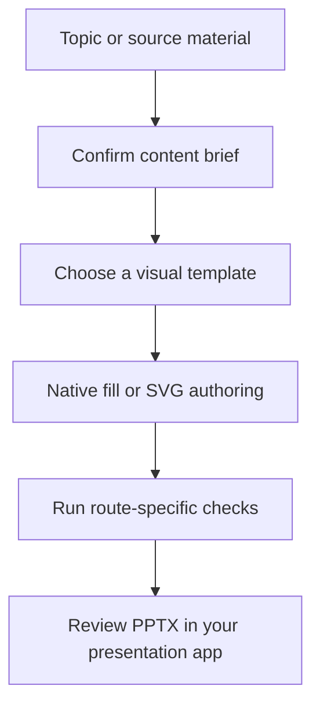

<div align="center">

# xmu-ppt

**A Xiamen University template library and PPTX workflow for AI agents.**
Start with a topic or source material, confirm a content brief and a template, then export a `.pptx` with editable text. Native filling reuses existing layouts. SVG authoring supports custom page composition.

[](https://github.com/Longfei-Tao/xmu-ppt/releases)
[](LICENSE)
[](docs/quickstart.md)
[](docs/templates.md)
[](https://github.com/Longfei-Tao/xmu-ppt/actions/workflows/validate.yml)
[](https://github.com/Longfei-Tao/xmu-ppt/stargazers)

[简体中文](README.zh-CN.md) · [Template gallery](https://longfei-tao.github.io/xmu-ppt/templates/) · [Slide-by-slide preview](https://longfei-tao.github.io/xmu-ppt/) · [Quick start](#quick-start) · [FAQ](docs/faq.md)

</div>

<table>
  <tr>
    <td align="center" width="33%">
      <a href="https://longfei-tao.github.io/xmu-ppt/#defense/1"></a><br/>
      <sub><b>Xiayuan Qingri</b> — 14-slide defense deck: emblem, campus photography and type scale kept</sub>
    </td>
    <td align="center" width="33%">
      <a href="https://longfei-tao.github.io/xmu-ppt/#group/8"></a><br/>
      <sub><b>Nanqiang Weilan</b> — 11-slide group report: body layouts recomposed per page, not card grids</sub>
    </td>
    <td align="center" width="33%">
      <a href="https://longfei-tao.github.io/xmu-ppt/#native/3"></a><br/>
      <sub><b>Phoenix Flower</b> — 9 slides filled inside the original PPTX; photos and bars untouched</sub>
    </td>
  </tr>
</table>

<sub>All three are PowerPoint screenshots of real exported files, not design mockups. [Flip through them online →](https://longfei-tao.github.io/xmu-ppt/)</sub>

> **Unofficial personal project.** Not affiliated with, endorsed by, or licensed by Xiamen University. Code and template structure are [MIT](LICENSE); the university emblem, campus photographs and fonts are **not** covered by that license. Redistribution status for some existing assets is still [under review](docs/assets.md).

## Capabilities

- 15 built-in XMU template decks in the full repository, including 14 with source `.pptx` files for native filling.
- A content-first workflow with explicit template selection, layout inspection, text fitting and structural checks.
- Local onboarding of your own `.pptx` templates, with `U001`-style identifiers and a private gallery.
- Native text, table and supported chart edits, plus SVG authoring for layouts that need to be composed freely.

Python scripts handle conversion and validation. The agent supplies the writing and page composition. Model access and billing belong to your chosen agent.

## How it works



The brief records page purpose, key messages, evidence and gaps. Say "skip the brief" for a fast draft, or explicitly authorize the agent to choose a template. The default native build checks content completeness, estimated text fit and template consistency. Page count follows the content and available layouts. Automated checks need a final visual review in PowerPoint, WPS or your target app.

## Three routes

| You say | Route | What happens | Trade-off |
| --- | --- | --- | --- |
| "Use this template, keep the layout" | **Native fill** (default) | Clone the source pages, replace text runs, keep transitions | Wording is bounded by each text box |
| "Compose the layout freely" | **SVG authoring** | Hand-author each page as SVG, then export to PPTX | Layout fidelity is approximate |
| "Keep every source page in order" for a registered local external template | **Strict native** | Copy the whole PPTX, replace specified text XML | Original page count and order are required |

`Nanqiang Weilan` ships no source `.pptx`, so it supports the SVG route only.

## Ask an agent to install

Paste this into Codex, Claude Code, Cursor, Copilot Agent mode or Gemini CLI with terminal access.

```text
Set up https://github.com/Longfei-Tao/xmu-ppt as a project-scoped skill
for the agent I am using. Inspect the repository README and
skills/xmu-ppt/SKILL.md first. Use the entire skills/xmu-ppt directory.
If CC Switch manages my shared skills, use that source of truth.
If a skill with the same name exists, compare sources and ask before replacing it.
Keep a full checkout for the built-in templates. Create a Python 3.10+
virtual environment and install requirements-core.txt with its interpreter.
Run the four-slide quickstart export and report the skill path, interpreter,
PPTX path, and whether the host actually discovers the skill.
```

Installation directories and invocation differ by host. [Agent setup and copyable commands](docs/tools/README.md) includes the current official references, an optional `npx skills add` path, and conflict handling.

## Quick start

**Requirements:** Python 3.10+, Git (or the ZIP below), and an AI agent that can read files and run Python.

### 1. Clone

```bash
git clone https://github.com/Longfei-Tao/xmu-ppt.git xmu-ppt
cd xmu-ppt
```

Without Git, download [main.zip](https://github.com/Longfei-Tao/xmu-ppt/archive/refs/heads/main.zip) and work inside the extracted `xmu-ppt-main` folder.

| Download | Contents | Intended use |
| --- | --- | --- |
| Git clone or GitHub source ZIP | Full repository, 15 built-in decks, 14 source PPTX files, examples and tests | Try the included XMU templates |
| [Release skill-only ZIP](https://github.com/Longfei-Tao/xmu-ppt/releases/latest/download/xmu-ppt-skill.zip) | Scripts, workflows, layout definitions and documentation, with originals and display images excluded by the packager | Supply your own template files |

The skill-only ZIP extracts to `xmu-ppt/skills/xmu-ppt/SKILL.md`. Use the **inner** `skills/xmu-ppt/` as the skill folder. Its built-in native sources and template images are absent, so add your own PPTX with `user_templates.py onboard` before using that workflow. Download availability and contents depend on the published release. The commands below use the full repository.

### 2. Install dependencies

```powershell
# Windows PowerShell
python -m venv .venv
.\.venv\Scripts\python.exe -m pip install -r skills/xmu-ppt/requirements-core.txt
```

```bash
# macOS / Linux
python3 -m venv .venv
.venv/bin/python -m pip install -r skills/xmu-ppt/requirements-core.txt
```

### 3. Ask your agent

Open the repository in a file-capable agent and send:

```text
Read skills/xmu-ppt/SKILL.md and follow its workflow.

Topic: a campus research collaboration report, about 10 slides.
Include material management, ownership, schedule and submission review.
There is no measured data — write it as a proposal, do not invent results.

Confirm a one-page content brief, then show the template shortlist and wait for my choice.
Use this repository's virtual environment and return the actual PPTX path.
```

Core conversion needs the five dependencies in `requirements-core.txt`. PDF, Word, web import, image generation, narration and browser review have additional dependencies described in [Advanced commands](docs/advanced.md).

### 4. Verify conversion

Using the virtual environment's Python, run this from the repository root.

```bash
python skills/xmu-ppt/scripts/svg_to_pptx.py examples/quickstart -s svg_output -o .cache/first-demo.pptx -t none -a none
```

Replace `python` with `.venv/Scripts/python.exe` on Windows or `.venv/bin/python` on macOS/Linux. A successful run reports four converted slides and writes `.cache/first-demo.pptx`. This checks conversion of the bundled example.

### Update

```bash
python skills/xmu-ppt/scripts/update_repo.py
```

Run the updater with the same virtual environment's Python in the original Git checkout. It refuses tracked local changes and uses `git pull --ff-only`. It synchronizes core dependencies on first use, when requirements change, or after an unsuccessful dependency installation. Use `--full` to track and install the full dependency set, or `--skip-pip` to skip dependency installation. ZIP and installed-copy users should update through the original download or installer, preserving local changes first.

## Use it in your agent

| Tool | Entry point | Verification status |
| --- | --- | --- |
| Codex | [Project skill and source invocation](docs/tools/codex.md) | Project skill discovery verified through app-server |
| Claude Code | [Project skill and `/xmu-ppt`](docs/tools/claude-code.md) | Project skill registration verified with an isolated control directory |
| Cursor | [Project skill and `/xmu-ppt`](docs/tools/cursor.md) | Official mechanism checked; host integration pending |
| GitHub Copilot | [Agent mode and project skill](docs/tools/copilot.md) | Copilot CLI project skill discovery verified; IDE acceptance pending |
| Gemini CLI | [Workspace skill](docs/tools/gemini-cli.md) | Native installation and trusted-workspace discovery verified |
| Web chat / other tools | [Requirements and manual flow](docs/tools/README.md) | Only works with a file-execution environment |

**Verification scope, 2026-11-09.** Core dependencies installed in a fresh Windows Python 3.13 environment, and the four-slide SVG example exported successfully. Four CLI hosts discovered the skill in temporary projects, and Skills CLI copied the complete skill successfully. Full model-driven creation needs separate acceptance in each host. The CI workflow defines Ubuntu/Windows and Python 3.10/3.13 jobs. See the [review record](docs/audits/2026-11-09-installation-review.md).

## Template library

Every deck has a **permanent three-digit serial**. Serials are append-only: adding a deck never renumbers an existing one, and a retired number is never reused. The serial is the deck's own identifier — `004` is not shorthand for a template ID such as `MED-004`; the registry is the single source of truth.

| Serial | Template | Style | Best for |
| --- | --- | --- | --- |
| `001` | 厦园晴日 · Xiayuan Qingri | Blue and white, campus photography, generous whitespace | Thesis defense, proposal, graduation talk |
| `002` | 凤栖青橙 · Fengqi Qingcheng | Rice-paper texture, Song type, green roof tiles | Humanities, course papers, reading reports |
| `003` | 南强蔚蓝 · Nanqiang Weilan | Blue-violet gradient, flat architectural illustration | Group meetings, project updates, competitions |

<details>
<summary><b>The other 12 themed decks (004–015)</b></summary>

| Serial | Template | Style |
| --- | --- | --- |
| `004` | 光影厦大 · Guangying Xiamen | Deep blue geometric light |
| `005` | 凤凰花开 · Phoenix Flower | Dark photography, flame-red accents |
| `006` | 厦大蓝 · XMU Blue | Clean blue and white, diagonal bars |
| `007` | 四季风景 · Four Seasons | Campus seasons, blue-white cards |
| `008` | 晕染风 · Watercolour Wash | Violet-blue wash, large margins |
| `009` | 晚霞 · Sunset | Warm orange geometry, dusk photography |
| `010` | 木棉花 · Kapok | Kapok photography, navy title bars |
| `011` | 清凉一厦 · Cool Campus | Pale green, campus illustration |
| `012` | 蓝天校门 · Blue Gate | Clear sky, minimal white |
| `013` | 米金书法 · Rice-Gold Calligraphy | Rice-gold ground, calligraphic motto |
| `014` | 经典蓝白 · Classic Blue | Classic blue and white, campus gate |
| `015` | 鹭江夜澜 · Egret River Night | Navy arcs, night campus, oversized chapter numerals |

</details>

Browse all 15 built-in covers in the **[template gallery](https://longfei-tao.github.io/xmu-ppt/templates/)** · [full index](docs/templates.md) (Chinese). All decks are 16:9 at 1280×720.

> **Optional private library.** The public repository distributes only the 15 built-in decks; third-party template originals and their covers are deliberately not published. If you have your own legally obtained collection, point `root.local.json` at that local folder and run `external_templates.py scan`. Files stay on your machine and are never uploaded by this project.

### Add your own PPTX as a template

```bash
.venv/bin/python skills/xmu-ppt/scripts/user_templates.py onboard \
  "/Users/me/my-templates/group-meeting.pptx" \
  --name "My group meeting" --rights-confirmed
```

On Windows use `.\.venv\Scripts\python.exe`. The command copies the deck to
`~/.xmu-ppt/user-templates/U001/` (`--link` keeps the original path instead),
generates a page catalogue and cover, assigns the local serial `U001`, and
writes a local-only gallery at `~/.xmu-ppt/user-templates/index.html`.
Use `list` to inspect entries and `doctor` to verify sources. These templates
never enter the public repository, a Release, or the public gallery.

## What you give, what you get

| Input | What the agent does | Output |
| --- | --- | --- |
| A topic or a rough idea | Builds the narrative, proposes a deck, waits for your template choice | `.pptx`; never invents research results |
| An outline, document or old deck | Extracts content, shows templates, maps it onto the chosen layouts | `.pptx` plus the project source you can keep editing |
| A template plus new copy | Clones the matching source pages and fills text, tables and charts where supported | `.pptx` bounded by the original layout capacity |

Text and simple shapes export as native objects. Photographs remain images, and complex charts or dense layouts need a manual pass — "editable text" does not mean every object is editable.

## Repository layout

```text
skills/xmu-ppt/          # the skill: SKILL.md, workflows, scripts and templates
  templates/decks/       # 15 built-in decks (SVG prototypes, 14 with source PPTX)
  templates/external/    # registry, categories and flags for an optional local library
  workflows/             # idea-to-ppt, native fill, strict-native, SVG authoring
docs/                    # guides, template index, asset licensing (Chinese)
examples/                # exported sample decks and a four-page demo
local-gallery/           # offline HTML gallery, generated from the catalogue
tests/                   # regression tests for the engine and the workflow gates
scripts/                 # repository maintenance and documentation checks
```

## Documentation

The detailed guides are currently written in Chinese. The English sections above are enough to install and run the project; these are the deeper references:

| Document | What is inside |
| --- | --- |
| [Quick start](docs/quickstart.md) | Environment setup, first deck, installing without Git |
| [FAQ](docs/faq.md) | Dependencies, line breaks, text capacity, updating, asset boundaries |
| [Templates](docs/templates.md) | All 15 decks, styles and selection guide |
| [Advanced commands](docs/advanced.md) | Full dependency set, optional tools, batch commands |
| [Agent setup](docs/tools/README.md) | Skill directories and invocation per host |
| [Assets and licensing](docs/assets.md) | Emblem, photography and font boundaries |

Sample decks live in [`examples/`](examples): a [four-page workflow demo](examples/quickstart/), a [14-slide defense deck](examples/房颤NLRP3答辩_厦园晴日.pptx), an [11-slide group report](examples/组会汇报_南强蔚蓝.pptx) and a [9-slide native fill](examples/原生填充_凤凰花开.pptx).

## Limits

- **It needs an agent.** The Python scripts analyse, convert and check; they do not call a model to write your deck. Your agent's account and costs are separate.
- **Real talks need real material.** Unverified results, references and personal data should be supplied or omitted — not guessed.
- **Environment changes layout.** Missing fonts change line breaks; SVG conversion and native fill each have their own boundaries. Check every page in the presentation app you will actually use.
- **"Local" is not automatic.** The conversion scripts run in your environment, but material you send to a cloud agent is still governed by that tool's data policy.
- **School assets are separate.** Public download availability is not a redistribution license. This project is not an official Xiamen University product.

## License

Code and template structure: [MIT](LICENSE). Assets are **not** covered by that grant — see [LICENSE-ASSETS](LICENSE-ASSETS) for the boundary and [Licensing and boundaries](docs/licensing.md) for the workflow. University marks, campus photographs, embedded fonts and other third-party assets remain with their owners; [Assets and licensing](docs/assets.md) records the evidence gaps.

## Credits

Built on the SVG → PPTX engine of [PPT Master](https://github.com/hugohe3/ppt-master) (MIT). Upstream attribution and license texts are kept in [CREDITS.md](CREDITS.md) and [THIRD_PARTY_NOTICES.md](THIRD_PARTY_NOTICES.md). Contributions are welcome — see [CONTRIBUTING.md](CONTRIBUTING.md).

<div align="center">
<sub><code>xmu-ppt</code> — formerly published as <code>xmu-xmu-ppt</code> / “XMU PPT Master”.</sub>
</div>
