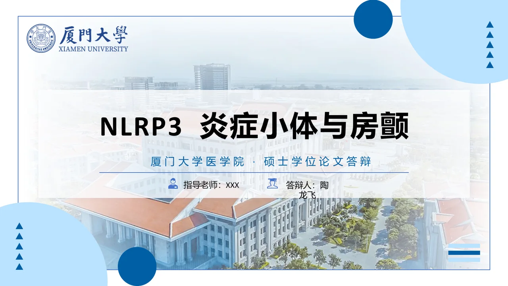
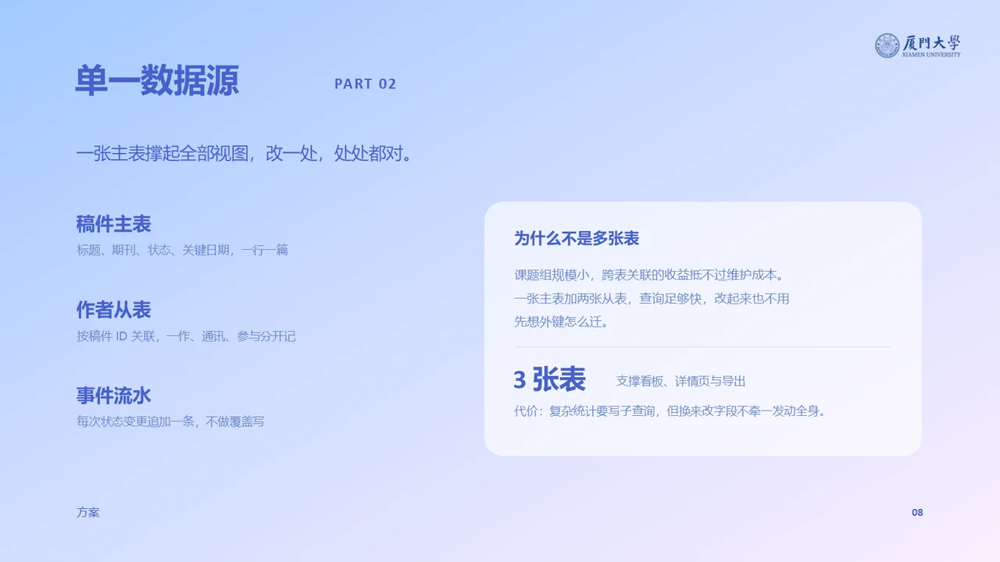
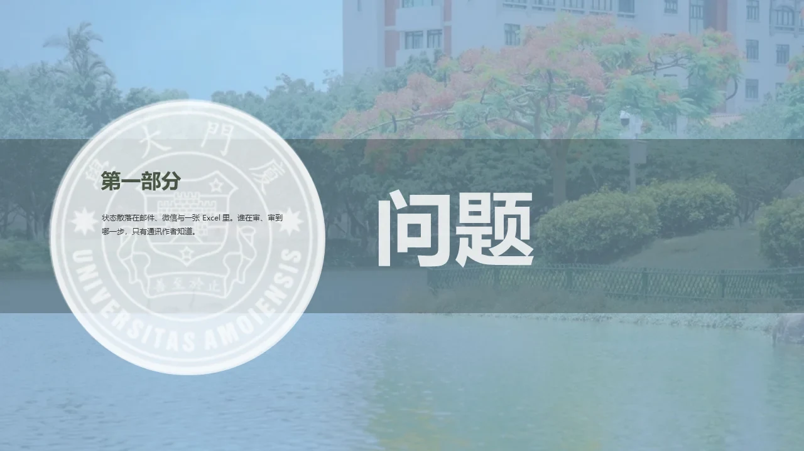

# xmu-ppt · 厦门大学 PPT 模板

[](https://github.com/Longfei-Tao/xmu-ppt/releases)
[](LICENSE)
[](docs/templates.md)
[](docs/quickstart.md)
[](https://github.com/Longfei-Tao/xmu-ppt/stargazers)

**简体中文** · [English](README.md)

把主题、提纲或现有材料，整理成厦大风格的演示文稿。由 AI Agent 逐页排版，导出**文字可编辑**的 `.pptx`。基于 [PPT Master](https://github.com/hugohe3/ppt-master) 的 SVG → PPTX 引擎，增补 15 套厦大模板与三条出稿路线。

**[选择视觉模板](https://longfei-tao.github.io/xmu-ppt/templates/)** · **[在线逐页预览](https://longfei-tao.github.io/xmu-ppt/)** · [快速开始](docs/quickstart.md) · [模板风格](docs/templates.md) · [常见问题](docs/faq.md) · [选择你的 AI 工具](docs/tools/README.md)

<table>
  <tr>
    <td align="center" width="33%">
      <a href="https://longfei-tao.github.io/xmu-ppt/#defense/1"></a><br/>
      <sub><b>厦园晴日</b> — 硕士答辩 14 页：校徽、校园照片与标题层级按模板还原</sub>
    </td>
    <td align="center" width="33%">
      <a href="https://longfei-tao.github.io/xmu-ppt/#group/8"></a><br/>
      <sub><b>南强蔚蓝</b> — 组会汇报 11 页：正文版式按内容重排，不是每页套卡片</sub>
    </td>
    <td align="center" width="33%">
      <a href="https://longfei-tao.github.io/xmu-ppt/#native/3"></a><br/>
      <sub><b>凤凰花开</b> — 原生填充 9 页：在原 PPTX 里换字，照片与色条不动</sub>
    </td>
  </tr>
</table>

<sub>三张图都是 PowerPoint 打开真实导出产物的截图，不是设计稿。[在线翻完这三套 →](https://longfei-tao.github.io/xmu-ppt/)</sub>

> 非官方个人项目，与厦门大学不存在已确认的授权或合作关系。代码与模板结构适用 [MIT](LICENSE)；校徽、照片、字体等不因此获得授权。部分既有素材的公开再分发条件仍[待核验](docs/assets.md)。

## 这是什么

| | |
| --- | --- |
| **是** | 一个 AI Agent 技能：给它主题或材料，它挑页、填字、检查，再导出可编辑 PPTX |
| **是** | 15 套厦大模板（3 套精修 + 12 套主题），其中 14 套支持直接在原始 PPTX 里填内容 |
| **不是** | 不是在线生成服务，也不是插件商店里的安装包；需要本地 Python 和能执行命令的 Agent |
| **不保证** | 复杂图表与原版式完全还原；照片仍是图片。上台前请用演示软件逐页检查 |

默认按 **提出需求 → 选择视觉模板 → 生成 PPT** 使用。AI 展示推荐与全部模板预览，等待你选定后连续制作。你已指定模板时直接采用；说“你帮我选”可授权 AI 代选。

每套模板有一个**固定的三位序号**（现有内置模板为 `001`–`015`）。序号只在末尾追加，不重排、不复用；说序号即可选模板，例如 `004` 指「光影厦大」，与模板 ID `MED-004` 不是一回事。

## 三条路线

模板保真和排版自由是矛盾的，所以分成三条路；只给主题时，先选模板，再默认采用第一条。

| 你的说法 | 路线 | 做法 | 代价 |
| --- | --- | --- | --- |
| 「保留原版式」「别改我的样式」「表格图表要原样」 | 原生填充（默认） | 克隆源页 + 改 `fill_plan`，不生成 SVG | 版式受槽位约束，文字长度有硬上限 |
| 只给主题或材料，排版可以自由 | SVG 出稿 | 逐页手写 SVG 再导出 | 每页重画，模板保真度中等 |
| 「一页不少、全部原样保留」 | 严格保真 | 整份复制原 PPTX，只覆盖被点名页的文字 | 页数必须等于模板原有页数 |

原生填充可用 14 套；`南强蔚蓝` 原始文件是 `.ppt`，仅支持 SVG 路线。

## 输入与输出

你可以直接这样说：

```text
用 xmu-ppt 做一份厦大风格的校园科研协作汇报，约 10 页。
内容包括：材料管理、责任分工、进度安排与提交复核。
先展示视觉模板供我选择，确认后再制作。
没有实测数据，请写成方案建议，不编造结果。输出 PPTX。
```

| 你提供什么 | Agent 如何处理 | 最终得到什么 |
| --- | --- | --- |
| 一个主题或想法 | 补全叙事结构，展示模板候选并等待选定 | `.pptx`；不会据此编造研究结果 |
| 提纲、文档或旧汇报材料 | 提炼内容，展示厦大模板，用户选定后逐页排版 | `.pptx` 和可继续修改的项目源稿 |
| 指定模板和新内容 | 克隆适用源页，填充文字与支持的表格、图表 | 受原版式容量约束的 `.pptx` |

默认只需接收演示文稿与必要说明。文字和简单图形可导出为原生对象，照片等仍是图片；复杂图表与排版需逐页检查，不能保证所有元素均可编辑或格式完全一致。

## 快速开始

需要 **Python 3.10+**、Git（或改用下面的 ZIP 方式），以及能读取文件和运行 Python 的 AI Agent。

### 准备源码

**方式 A · Git（推荐，后续可一行命令更新）**

```bash
git clone https://github.com/Longfei-Tao/xmu-ppt.git xmu-ppt
cd xmu-ppt
```

**方式 B · 下载 ZIP（没装 Git 时用）**

下载 [main.zip](https://github.com/Longfei-Tao/xmu-ppt/archive/refs/heads/main.zip) 并解压，进入解压出来的 `xmu-ppt-main` 目录。ZIP 版没有 git 历史，升级时重新下载覆盖，先备份自己改过的模板。

### 安装依赖

```powershell
# Windows PowerShell
python -m venv .venv
.\.venv\Scripts\python.exe -m pip install -r skills/xmu-ppt/requirements-core.txt
```

```bash
# macOS / Linux
python3 -m venv .venv
.venv/bin/python -m pip install -r skills/xmu-ppt/requirements-core.txt
```

### 把需求交给 Agent

在 AI 工具中打开这个仓库，把下面一段发给它，即可先从源码使用，无需修改全局配置：

```text
请读取 skills/xmu-ppt/SKILL.md，按其中的厦大工作流制作上一条需求的 PPT。
以该文件所在目录为技能根目录，使用本仓库 .venv 内的 Python。
把生成文件放在独立项目目录中，完成后给我 PPTX 的实际路径。
```

第一次使用时把“上一条需求”替换成自己的主题，或先发送上面的示例需求。完整步骤、环境说明及常见问题见[快速开始](docs/quickstart.md)。

### 更新到最新版

```bash
python skills/xmu-ppt/scripts/update_repo.py
```

它会先检查本地改动，有未提交的修改就停下让你处理；然后拉取最新代码，**只在 `requirements.txt` 变化时**才重装依赖，加 `--skip-pip` 可跳过依赖同步。ZIP 用户重新下载覆盖即可。

已有仓库也可以直接用 git：

```bash
git pull
```

注意 `git pull` 会覆盖同名文件，自己改过的模板请先另存或提交到独立分支。

## 在你的 AI 工具中使用

| 工具 | 使用入口 | 本仓库验证范围 |
| --- | --- | --- |
| Codex | [项目 Skill 与源码调用](docs/tools/codex.md) | 当前 Windows 会话已运行本地脚本；未做全新安装验收 |
| Claude Code | [项目 Skill 与 `/xmu-ppt`](docs/tools/claude-code.md) | 已按官方机制编写文档，未实机验证 |
| GitHub Copilot | [Agent 模式与项目 Skill](docs/tools/copilot.md) | 已按官方机制编写文档，未实机验证 |
| Gemini CLI | [工作区 Skill](docs/tools/gemini-cli.md) | 已按官方机制编写文档，未实机验证 |
| 网页聊天或其他工具 | [环境要求与手动流程](docs/tools/README.md) | 有文件执行环境才可能运行；不承诺原生安装 |

使用 CC Switch 管理共享 Skills 时，请在 CC Switch 中维护和分发；不要直接覆盖它生成的客户端副本。本仓库尚未提供插件商店安装包或远程 MCP 服务。

**用哪个模型？** 本仓库不调用模型，排版与文案由你选的 Agent 完成，所以任何能执行命令的 Claude / GPT / Gemini / 本地模型都能跑。差异主要来自上下文窗口：稿子越长，模型越容易忘记 `spec_lock.md` 里的配色与字号，10 页以上建议用上下文大的模型。

## 选择风格

| 风格 | 适合的内容 |
| --- | --- |
| 厦园晴日：蓝白、校园照片、明亮留白 | 答辩、开题、毕业汇报 |
| 凤栖青橙：纸感、青绿、橙色点缀 | 人文社科、读书报告、课程展示 |
| 南强蔚蓝：蓝紫、建筑插画、分栏结构 | 组会、项目与工作汇报；目前仅 SVG 路线 |

还有凤凰花开、经典蓝白、米金书法等 12 套主题，序号 `004`–`015`。[查看完整清单与既有原型](docs/templates.md)。

## 示例与文档

| 示例 | 内容 |
| --- | --- |
| [四页工作流演示](examples/quickstart/) | 不含校徽与照片，用于验证导出链路是否可用 |
| [硕士答辩 14 页](examples/房颤NLRP3答辩_厦园晴日.pptx) | 厦园晴日，含校园照片与原生文字 |
| [组会汇报 11 页](examples/组会汇报_南强蔚蓝.pptx) | 南强蔚蓝，逐页按内容重排 |
| [原生填充 9 页](examples/原生填充_凤凰花开.pptx) | 在原始模板里填字，版式未改动 |

| 文档 | 内容 |
| --- | --- |
| [快速开始](docs/quickstart.md) | 环境准备、首次出稿、没有 Git 怎么装 |
| [常见问题](docs/faq.md) | 安装、依赖、换行、容量、更新、素材边界 |
| [模板总览](docs/templates.md) | 15 套模板清单与既有原型 |
| [进阶命令](docs/advanced.md) | 完整依赖、可选工具、批量命令 |
| [选择你的 AI 工具](docs/tools/README.md) | 各宿主的技能目录与调用方式 |
| [素材与许可](docs/assets.md) | 校徽、照片、字体的边界与核验状态 |

## 开源与自备模板

本仓库基于 [PPT Master](https://github.com/hugohe3/ppt-master) 的 SVG → PPTX 引擎，
授权治理也沿用上游做法：**代码按 MIT 开源，第三方模板不随仓库分发**。用户自己的模板
留在本机，由技能只读扫描，既不上传也不打包。

| 你想做的事 | 怎么做 |
| --- | --- |
| 只用内置 15 套 | 直接 clone，或下载 Releases 的纯技能包 |
| 用自己购买 / 收集的模板 | 复制 `root.example.json` 为 `root.local.json`，填入模板目录；再运行扫描与预览渲染 |
| 生成一份可公开分发的技能包 | `python scripts/pack_release.py`，脚本会拒绝装入任何原件、截图或本机配置 |
| 核验素材边界 | `python scripts/check_assets.py`，0 error 才能发布 |

权利声明、逐套台账与更新政策见[外部模板声明](skills/xmu-ppt/templates/external/TEMPLATE_NOTICES.md)、
[素材授权边界](LICENSE-ASSETS)与[素材与许可](docs/assets.md)。别人下载后可以在自己电脑上
获得与本机等价的模板浏览与原生填充能力，模板由各自提供、权利由各自核验。

## 使用前了解

- **生成需要 Agent。** Python 脚本负责分析、转换与检查，不会独立调用大模型完成主题创作；AI 工具本身的账号或费用另计。
- **真实汇报需要真实材料。** 未提供的实验结果、参考文献、个人信息应省略或补充来源，不能让模型猜测。
- **效果受环境影响。** 缺少字体会改变换行；SVG 转换与原生填充也各有边界。上台前请用目标演示软件检查全部页面。
- **数据不自动“全程本地”。** 转换脚本在执行环境运行，交给 AI 的材料仍受所选工具的数据政策影响；云端也无法直接访问本机路径。
- **学校素材单独核验。** 公开下载入口不等于公开再分发许可；本项目不代表厦门大学官方出品。

**素材不在 MIT 范围内。** 代码与模板结构的许可见 [LICENSE](LICENSE)；素材边界、允许用途与逐套台账见 [LICENSE-ASSETS](LICENSE-ASSETS) 与 [授权与边界设计](docs/licensing.md)。

---

<sub>项目名 `xmu-ppt`；技能名沿用上游的 `xmu-ppt`。旧称 `xmu-xmu-ppt`、XMU PPT Master 均指本仓库。</sub>

[进阶命令与依赖](docs/advanced.md) · [贡献指南](CONTRIBUTING.md) · [素材与许可](docs/assets.md) · [上游致谢](CREDITS.md)
