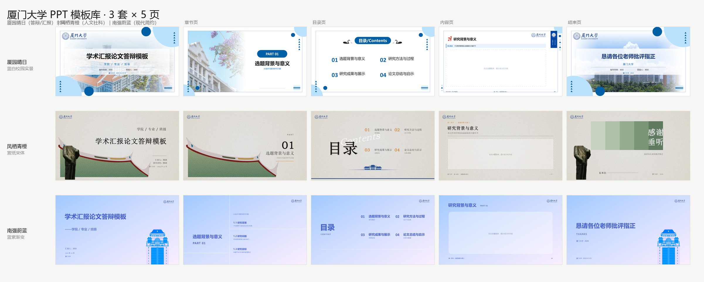

# 模板与风格

[返回首页](../README.md) · [素材来源与待核验项](assets.md)

下图是仓库已有的三套精修模板原型总览（非 14 套全景、非完成汇报稿）。其中校徽和校园素材的公开再分发授权待核验，本次未新增或复制这类素材。历史 ID 中的“官方”不代表项目获官方授权。

## 模板库（纯厦大，共 14 套 + 1 个品牌预设）

> 全部模板均为 16:9 / 1280×720。14 套均有 SVG 原型，其中 13 套还包含原生填充资产；`厦门大学_官方_南强蔚蓝` 目前仅支持 SVG 出稿，缺少下列源 PPTX 和索引，不能用于原生填充：
>
> - `source.pptx` — 原始 PPTX（剥离内嵌字体、压缩过图片，具体体积变化依源文件而异），原生填充的克隆源，页数与版式完整
> - `layout_index.json` — 版式画像：每页是封面 / 目录 / 章节 / 几宫格 / 编号卡片，以及字号与槽位数量
> - `01_cover.svg` … `04_ending.svg` — 5 页 SVG 原型，供 SVG 出稿路线使用

### 精修模板（3 套）

| 模板 ID | 风格 | 适用场景 |
| --- | --- | --- |
| `厦门大学_官方_厦园晴日` | 蓝白校园实景、半透明白卡、三角装饰 | 论文答辩、开题、预答辩、毕业汇报 |
| `厦门大学_官方_凤栖青橙` | 宣纸底纹、宋体大字、绿瓦屋顶、陈嘉庚雕像 | 人文社科答辩、课程汇报、读书报告 |
| `厦门大学_官方_南强蔚蓝` | 蓝紫渐变、扁平建筑插画、分栏白线 | 组会、工作汇报、项目进展、竞赛路演 |

> **关于模板 ID 里的「官方」二字**：这是早期目录命名，含义是「按学校视觉规范精修重制」，**不代表厦门大学官方出品或授权**。该命名已被示例、命令与索引文件大量引用，为不破坏现有用法而保留，请勿据此认为本项目获得学校认可。

另有 `厦门大学` 品牌预设（`skills/ppt-master/templates/brands/厦门大学/`），只锁校徽、配色、字体与语气，页面可自由排版。

### 主题风格（11 套，含转换后的 SVG 原型）

按 PPT Master 官方 create-template 的 mirror 模式转换；页面保留原示例文字，使用时只替换文字、不动版式。

| 模板 ID | 风格 |
| --- | --- |
| `厦门大学_主题_光影厦大` | 深蓝几何光影 + 光影校园照 |
| `厦门大学_主题_凤凰花开` | 深色照片底 + 凤凰花红 |
| `厦门大学_主题_厦大蓝` | 清爽蓝白 + 建筑照片 + 斜向蓝条 |
| `厦门大学_主题_四季风景` | 校园四季实景照片 + 蓝白卡片 |
| `厦门大学_主题_晕染风` | 紫蓝水彩晕染 + 大面积留白 |
| `厦门大学_主题_晚霞` | 暖橙几何 + 晚霞校园照片 |
| `厦门大学_主题_木棉花` | 木棉花照片 + 深蓝半透明标题条 |
| `厦门大学_主题_清凉一厦` | 浅绿清新 + 校园插画 |
| `厦门大学_主题_蓝天校门` | 蓝天校门实景 + 简洁白底 |
| `厦门大学_主题_米金书法` | 米金底色 + 书法校训 + 庄重 |
| `厦门大学_主题_经典蓝白` | 经典蓝白 + 校门照片 |

> 注意：主题模板是“结构原型”——颜色、照片、版式尽量保留，但原图表对象会以占位符形式呈现，示例文字需在生成时整体替换。追求接近源 PPTX 的外观时，优先使用具备原生源文件的模板，并在目标演示软件中核对。

## 快速选型

| 你的场景 | 推荐模板 |
| --- | --- |
| 论文答辩 / 开题 / 毕业汇报 | `厦门大学_官方_厦园晴日`，或 `厦门大学_主题_经典蓝白` |
| 人文社科 / 读书报告 / 课程作业 | `厦门大学_官方_凤栖青橙`，或 `厦门大学_主题_米金书法`、`厦门大学_主题_晚霞` |
| 组会 / 工作汇报 / 项目进展 | `厦门大学_官方_南强蔚蓝`，或 `厦门大学_主题_光影厦大` |
| 需要特定视觉风格 | 直接点名 `厦门大学_主题_*` 下的原型 |
